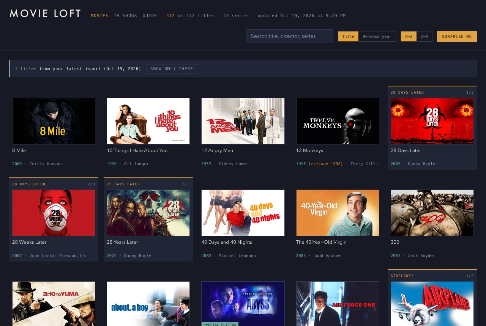
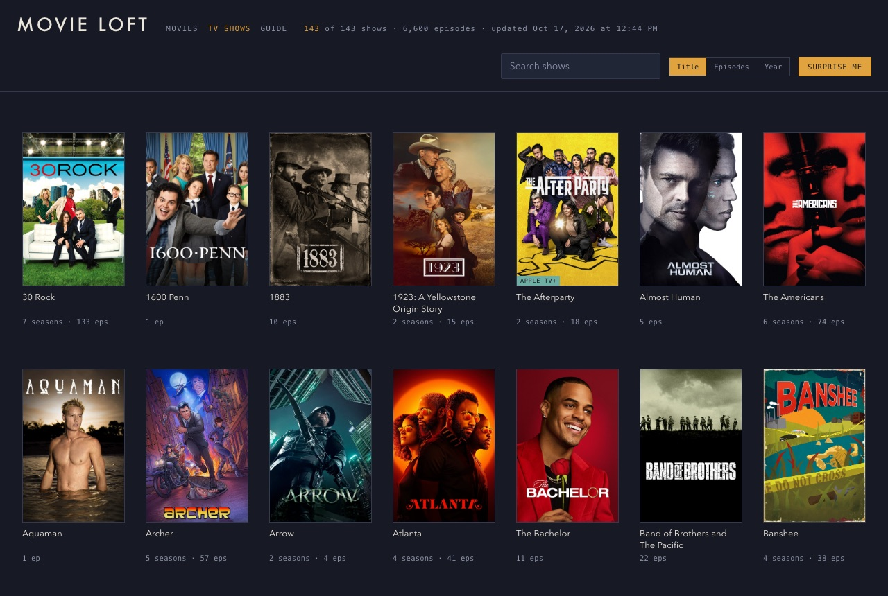
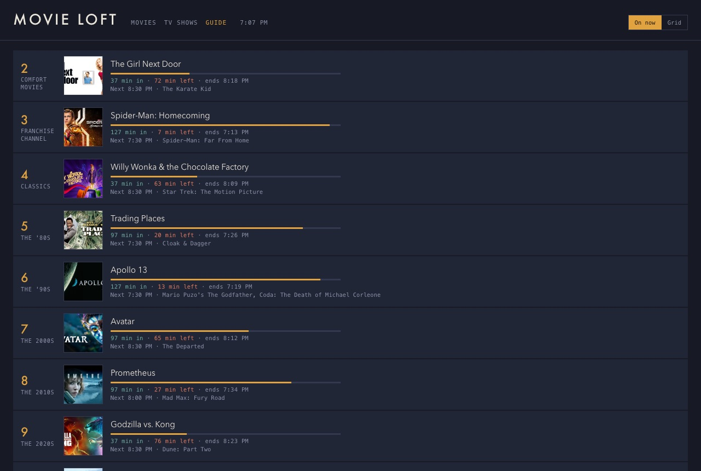
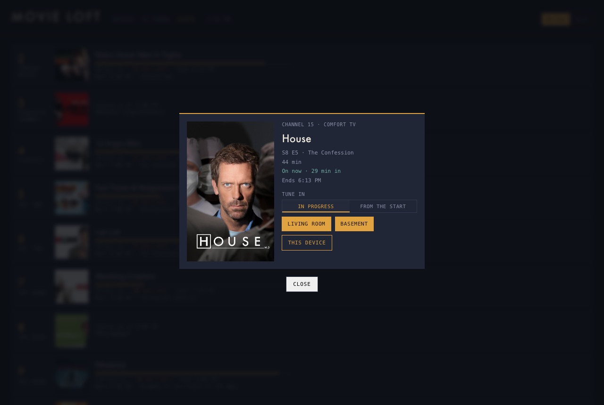

# Movie Loft

**Your Apple TV library, with a channel guide.**

> **A note on who did what.** Movie Loft was built with
> [Claude Code](https://claude.com/claude-code), Anthropic's AI coding tool,
> and Claude did the heavy lifting. It wrote essentially all of the code: the
> AppleScript export, the data cleanup, the channel scheduler, the web server,
> and the software that drives the Apple TVs. It also drafted this page. My
> part was the idea, the decisions (what to build, which channels, how Tune in
> should behave), testing everything on real TVs, and the stories that are
> mine to tell. When this page says "I," that's me; most of the building was
> Claude.

You own hundreds of movies and thousands of TV episodes in the Apple TV app,
and every night you scroll past all of them looking for something to watch.
Movie Loft turns that library back into something you browse the way you used
to browse a video store, and into something you can just *turn on* the way you
used to turn on cable.

It's named after the Movie Loft, the video store where I worked all through
high school.

---

## Why it had to be built

### The idea already existed, just not for this library

There are apps that do the channel-guide trick beautifully.
[Coax](https://coaxtheapp.com/), by indie developer Carter Fort, is the one
that got me started. I found it through fellow Brandeis alum Lex Friedman's
[Lex on Tech](https://lexontech.org/indie-developer-spotlight-carter-fort-built-coax-so-your-local),
in his spotlight "Carter Fort built Coax so your local library is always
'on.'" Point Coax at a Plex, Jellyfin, or Emby server and it scans your
library and builds a lineup of channels you can flip through. That's exactly
what I wanted, but my library isn't on a Plex server. It's hundreds of movies
and thousands of episodes bought over the years in iTunes and then the Apple
TV app.

### You can't get an Apple library into Plex, at least not legally

Most of what you "buy" in the Apple TV app is a license to stream it from
Apple's servers. Even the titles you can download come wrapped in Apple's
FairPlay copy protection, which only Apple's own apps will play. To Plex,
Jellyfin, and Emby, they're unplayable files.

The workaround people use is software that strips the copy protection off.
In the US, that breaks the anti-circumvention rules in the DMCA, even for
movies you paid for. Ripping your own DVDs and Blu-rays runs into the same
rule, since those are copy-protected too. Plenty of people do it anyway. I
didn't want a project built on that, and I wasn't going to re-buy a library
I already own.

### Apple doesn't make it easy to even *look* at your library

With the video off the table, the next question was whether I could at least
get the list. Apple doesn't make that simple either:

- **There's no API** for your personal Apple TV library.
- **The library file is encrypted**, so you can't just read it off the disk.
- **Apple's public search API no longer returns movies**, which closed off
  the usual way of looking titles up.
- **The Apple TV app has no "Copy Link,"** so even getting a shareable link to
  one of your own movies takes detective work.

### The trick: move the remote, not the movie

What finally cracked it was a change of approach: **don't move the video at
all.** Leave every movie and episode exactly where it is, on Apple's servers,
playing in Apple's own app on Apple's own hardware, the way it always has.
Movie Loft just reads the *list* and then works the *remote*:

- **It reads the catalog** the one way Apple still allows: by asking the
  Apple TV app directly, with AppleScript, on a Mac.
- **It builds the guide** from that list.
- **When you tune in**, it tells your Apple TV to open the title and jump to
  the right minute, the same as if you'd picked it yourself and scrubbed
  ahead.

Nothing gets copied, cracked, or moved. Apple's protection stays intact,
because Movie Loft never touches the video.

### The parts that took the longest

- **The TV data is a mess.** Buy a complete series and every episode can land
  in "season 0," with the real numbers buried in the titles, and trailers and
  featurettes filed between episodes as if they were episodes. Untangling
  thousands of raw rows into clean seasons took a whole set of rules, and a
  test suite of every weird case to keep them honest.
- **Apple TVs are fussy about being told what to do.** Jumping to a minute
  sounds simple. In practice, the Apple TV drops a jump sent too early,
  reports the wrong position while a video is playing, and gets stuck
  half-paused if you pause it while it's still loading. The working sequence
  was found by trial and error, with someone standing at the TV calling out
  what was on screen.
- **Finding Apple's own ID for every episode** meant reading the same
  behind-the-scenes episode list Apple's website uses, then matching titles
  carefully. Apple numbers some shows differently than the Apple TV app does
  (a two-part pilot can shift a whole season by one).
- **No opening holes in the home network.** My phone is managed by my
  employer, so a VPN back home wasn't an option. Instead, a small helper on
  the Mac checks in with the Movie Loft server and picks up Tune in requests.
  It only ever calls out; nothing at home accepts connections from the
  internet.

---

## What it does

### Your whole library, on one page

- **Every movie you own**, as a wall of covers you can scroll, sort by title or
  by year, and search.
- **Franchises stay together.** *Mission: Impossible*, *Alien*, the Avengers,
  and Bond each sit in one row in release order, even the entries whose titles
  don't say which series they belong to (*Prometheus*, *Logan*).
- **The real year.** The Apple TV app dates movies by when the digital version
  came out, so *Goodfellas* shows up as 2015. Movie Loft shows the theatrical
  year and notes the reissue: **1990 (reissue 2015)**.
- **"Surprise me"** picks a random movie when you can't decide.
- **What's new** gets its own banner, so recent purchases don't get lost in
  the pile.

### TV shows, cleaned up

The Apple TV app's TV data is a mess. Complete-series purchases hide the real
season and episode numbers inside the titles. Trailers and featurettes sit in
the middle of seasons, numbered as if they were episodes. Seasons you bought
twice show up twice. Movie Loft sorts all of that out, so every show is just
its seasons and episodes, in order, with a proper poster.

### Comfort picks

Tap ♥ on the movies and shows you'd put on any night: the ones you've seen
twenty times and will see twenty more. Filter down to just those when you want
something easy. They also get their own channels in the guide.

### The Guide

This is the part that's hard to explain until you see it. Movie Loft runs a
**cable-style channel lineup made entirely from your own library**, a full
broadcast day, every day. Mine has 28 channels, because I run three copies of
the busiest formats, the way cable had HBO, HBO2, and HBO3; out of the box
it's around 18.

- **Real channels with a point of view:** The Franchise Channel (whole series,
  in order), decade channels, Director's Chair, Super Heroes, Starfleet, The
  Half Hour, The Hour, Marathon (several episodes of one show back to back),
  Movie Roulette, Channel Surf, Comfort Movies, Comfort TV… and **The Aria
  Channel**, which plays *Frozen*. Only *Frozen*. Forever. (More on that
  below. Yours can loop whatever you like.)
- **It behaves like TV.** Channels start at 2, like the cable box you
  grew up with. Programs start on the hour and half hour. The day
  runs from 6 AM to 6 AM. When a channel runs out of things that fit before
  6 AM, it signs off with a test pattern.
- **The same lineup on every screen.** It isn't random: each day's schedule is
  worked out from the channel and the date. Your phone, your laptop, and your
  partner's iPad all show the same thing on Channel 7 at 9:30 tonight.
- **No reruns colliding.** A movie or show is never on two channels at once.
- **On Now** shows what's playing right now on every channel, how far in it
  is, and how many minutes are left. **Grid** is the classic TV-guide
  timetable.

#### The Aria Channel

Like plenty of couples who have dogs but not kids, April and I have head
canon about our dogs' personalities: years of inside jokes, endlessly
entertaining to exactly two people.

The first time Aria saw snow, she burrowed straight into it, and April
declared, "So she's a snow dog." From there the head canon… snowballed
(sorry). Aria loves *Frozen*. Aria always wants to build a snowman. Aria has
a stuffed Olaf. Aria tells her brother, "Go away, Franklin." Aria is the
Princess of Arendelle. And whenever I ask April if she wants to watch a
movie, Aria always chimes in: she wants to watch *Frozen*.

So when I was telling April about Movie Loft, she said, "You should have a
channel called The Aria Channel that just plays *Frozen* on a loop."

Now there is. It's channel 29.

### Tune in

See something in the guide you want to watch? Tap it, then tap a room.

- **Your Apple TV turns on, opens that movie or episode, and jumps to where
  the "broadcast" is right now**, then waits paused for you to press Play.
  You walk in partway through, just like real TV, except you can pause.
- **Or start from the beginning** with one toggle.
- **Exact episodes, too:** tune into *Seinfeld*, and you get that episode of
  *Seinfeld*, at that minute.
- **This device** opens it in the Apple TV app on your phone, iPad, or Mac
  instead.

### Streamed shows, mixed in

Shows you stream but don't own, like *Ted Lasso*, *The Pitt*, or *The Bear*,
can join the guide alongside your library, marked with their service. Tell
Movie Loft which services you have (Apple TV+, HBO Max, Hulu, Disney+, Prime
Video, Paramount+, Peacock) and which shows you want; it works out where each
one streams. Tune in opens the episode in that service's app and jumps to the
minute, the same as for anything you own. It's built for ad-free plans: on
an ad tier it still gets there, but it waits out the ads first, with some
stuttering along the way. Netflix isn't supported: it doesn't share its
catalog with Apple's.

### One command to stay current

Buy something new, run one command, and a few minutes later it's in your
library pages and on the guide's channels, with its cover, its real year,
and its Tune in link.

### Private by design

Movie Loft sits behind Google sign-in, open only to the accounts you list.
Save it to your phone's home screen and it opens like an app. Its database
holds just two things: the titles you've tagged as comfort picks, and a log
of Tune in requests. Your library itself lives in your own private GitHub
repo.

---

## How it works (the short version)

Apple doesn't offer a way to read your Apple TV library from outside the
Apple TV app, so Movie Loft asks the app itself: an AppleScript reads your
library on a Mac and saves it as plain text files. A set of Python scripts
cleans that up, looks up posters, real release years, and Apple TV links, and
builds the pages. The guide's schedule is worked out in your browser. A small
web server keeps it private and passes Tune in requests to a helper on your
Mac, which controls your Apple TVs over your home network. Nothing at home is
exposed to the internet: the helper only ever calls out.

## What you need

- A **Mac** with the **Apple TV app**, signed in to the account that owns your
  library. It runs the update and the Tune in helper.
- One or more **Apple TVs** for Tune in (optional; the pages and guide work
  without one).
- A free **TMDB** account, for posters and release years.
- For the hosted, private version: a host that runs Docker and Postgres, and
  a **Google Cloud** OAuth client for sign-in. I use
  [Railway](https://railway.com), on the Pro Workspace plan I already have
  for this and other projects; Movie Loft on its own should fit a
  lower-priced plan, and other hosts work too.

## Honest limitations

- **Apple-only, and US-store-shaped.** It reads the Apple TV app and drives
  Apple TVs. Links and lookups assume the US storefront.
- **Built on things Apple doesn't promise to keep.** The Apple TV app's
  scripting support, the episode list on Apple's website, and Apple TV remote
  control all work today and could change without notice. When one breaks,
  the rest keeps working (Tune in falls back to opening the show's page, for
  example), but something will need fixing.
- **Tune in needs a Mac that stays on**, on the same network as your Apple
  TVs.
- **It's a personal project.** It started as one library in one house. It's
  been generalized so anyone can run it, but expect some setup and the
  occasional rough edge.

---

## Try it yourself

The code is on GitHub: **[jnassi/movie-loft](https://github.com/jnassi/movie-loft)**,
MIT-licensed. The README walks through setup in levels, from library pages on
your Mac to the full guide with Tune in, and you can stop at any level. If
you try it, I'd love to hear how it goes.

---

*This product uses the TMDB API but is not endorsed or certified by TMDB.*
